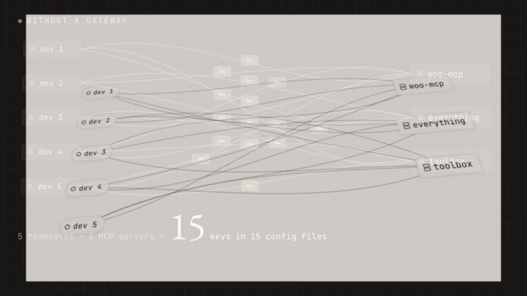
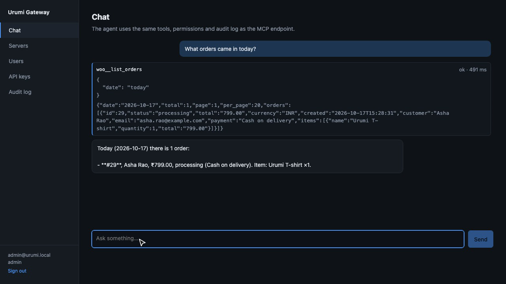
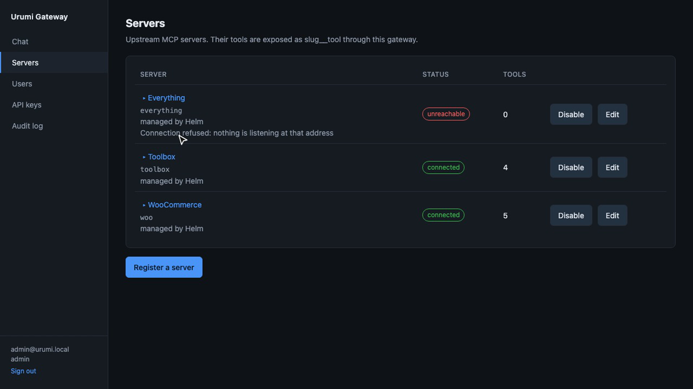
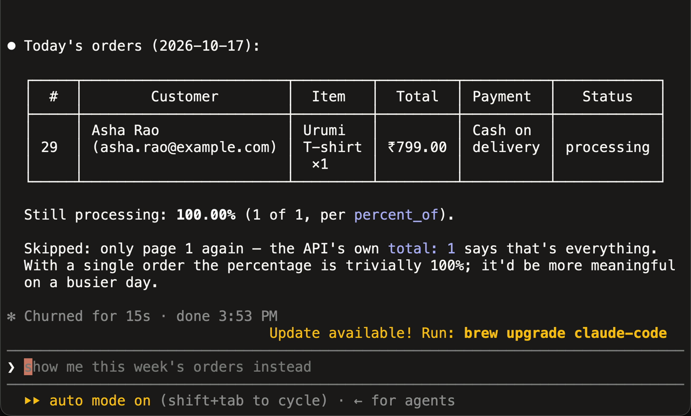
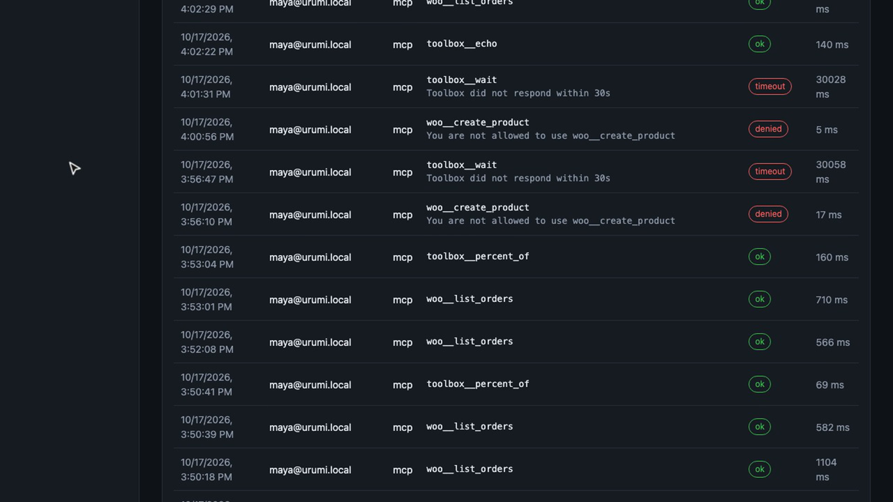
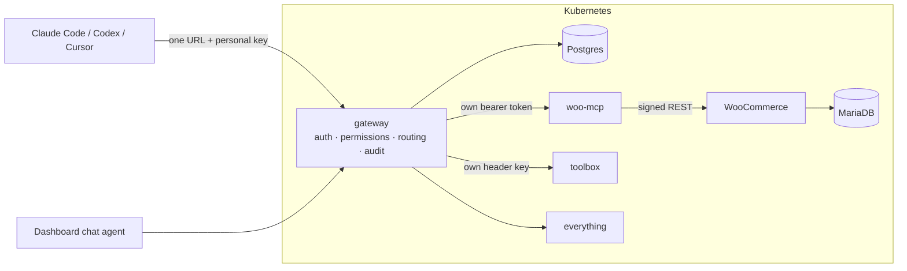
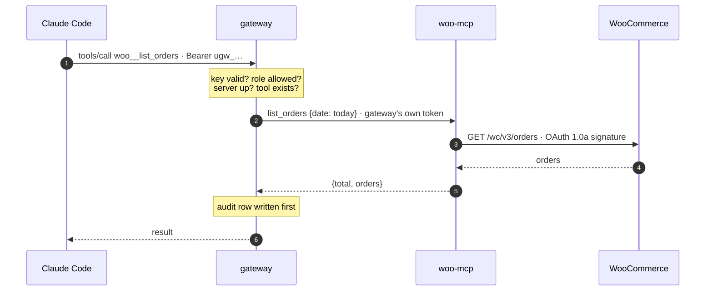

<p align="center">
  <picture>
    <source media="(prefers-color-scheme: dark)" srcset="docs/assets/logo-dark.svg">
    
  </picture>
</p>

<p align="center">
  <strong>One URL. One key per person. Every MCP server your team uses.</strong><br>
  A self-hosted team MCP gateway on Kubernetes, with a WooCommerce store as its first data source.
</p>

<p align="center">
  <a href="#quickstart"></a>
  <a href="docs/verification.md"></a>
  
  
  
  <a href="LICENSE"></a>
</p>

<p align="center">
  <a href="docs/assets/demo.mp4"></a><br>
  <sub>▶ <a href="docs/assets/demo.mp4">Watch the 41-second film</a> · the problem, the idea, one request end to end, and the proof</sub>
</p>

---

## Why

Without a gateway, five teammates using three MCP servers means fifteen copies of
fifteen credentials in fifteen config files, and nobody knows who called what.

**Urumi** puts every MCP server behind one endpoint. An admin connects each server
once. Every teammate gets their own revocable API key and sees every tool, in Claude
Code, Codex, Cursor or the built-in chat agent, and never sees an upstream credential.
Every call lands in an audit log under the person who made it.

## Connect your AI client

Create a key in the dashboard under **API keys** (no gateway yet? see [Quickstart](#quickstart)), then pick your client.

**Claude Code: plugin** (adds the server and a skill that knows the tools)

```bash
export URUMI_GATEWAY_URL=http://app.127.0.0.1.nip.io URUMI_API_KEY=ugw_...
```
```
/plugin marketplace add kazuma761/urumi-mcp
/plugin install urumi-gateway@wook8-mcp
```

**Claude Code: one command**

```bash
claude mcp add --transport http urumi http://app.127.0.0.1.nip.io/mcp --header "Authorization: Bearer ugw_..."
```

**Codex, Cursor, Claude Desktop, any stdio client** via the [`wook8-mcp`](packages/wook8-mcp) bridge

```toml
# ~/.codex/config.toml
[mcp_servers.urumi]
command = "npx"
args = ["-y", "wook8-mcp", "connect"]
env = { URUMI_GATEWAY_URL = "http://app.127.0.0.1.nip.io", URUMI_API_KEY = "ugw_..." }
```

Every client sees the same tools: `woo__list_orders`, `woo__create_product`,
`everything__echo`, `toolbox__echo` and the rest. Try *"What orders came in today?"*
All clients, including MCP Inspector and JSON configs: [docs/connecting-clients.md](docs/connecting-clients.md).

> **No gateway, just a store?** `npx -y wook8-mcp woo` runs the WooCommerce MCP server
> against any WooCommerce site with a REST key. See [packages/wook8-mcp](packages/wook8-mcp).

## What you get

| | |
| --- | --- |
| 🔌 **One endpoint** | `/mcp` lists the tools of every enabled server and routes each call to the right one. |
| 🏷️ **Collision-proof names** | Tools are always `<server>__<tool>`: `everything__echo` and `toolbox__echo` coexist. |
| 🔑 **Keys per person** | Self-service API keys, stored only as hashes, revocable on the next call. |
| 🧾 **Audit log** | Who, which server and tool, when, how long, and the outcome, for every call. |
| 🛡️ **Credentials stay home** | Upstream secrets are encrypted at rest and never reach a browser, client or model. |
| 🚦 **Fault isolation** | A dead or slow upstream shows as Unreachable; listing and other servers keep working. |
| 🧑‍⚖️ **Tool permissions** | Make any tool admin-only: hidden from members and refused if called by name. |
| 💬 **Chat agent** | An LLM tool loop in the dashboard that calls tools as the logged-in user. |
| 🛒 **WooCommerce MCP server** | Our own: products and orders as five tools, signed REST calls, store-timezone "today". |
| ☸️ **Kubernetes-native** | Three Helm charts, default-deny NetworkPolicies, non-root containers, local and prod via values only. |

<p align="center">
  
  
</p>
<p align="center">
  
  
</p>
<p align="center"><sub>Chat agent · an upstream goes down, the rest keep working · Claude Code with a member's key · audit log</sub></p>

## Quickstart

Requirements: Docker (about 4 GB of memory), `kubectl`, `helm`, `k3d`, Node 22+, `pnpm`, `jq`.

```bash
git clone https://github.com/kazuma761/urumi-mcp.git && cd urumi-mcp
./scripts/quickstart.sh
```

It checks your tools, creates a local k3d cluster, builds and installs everything, then prints:

```
Storefront          http://store.127.0.0.1.nip.io
WooCommerce admin   http://store.127.0.0.1.nip.io/wp-admin   admin / <generated>
Dashboard           http://app.127.0.0.1.nip.io              admin@urumi.local / <generated>
MCP endpoint        http://app.127.0.0.1.nip.io/mcp          (create a key under API keys)
```

`make e2e` then runs the 82 end-to-end checks against what was installed. Deploying to
a server instead: [docs/deployment.md](docs/deployment.md).

## How it works



A single call, from question to store and back:



Nine more diagrams (Kubernetes topology, the routing decision, the chat loop, failover,
onboarding, credential hops, data model): **[docs/architecture.md](docs/architecture.md)**.

## Using it

**Place an order.** Open the storefront, add a product to the cart, check out with
**Cash on delivery**. The order appears in WooCommerce admin under *Orders*.

**Invite a teammate.** Dashboard → **Users** → invite. Send them the single-use link;
they set a password and create their own key under **API keys**.

**Manage servers.** Dashboard → **Servers**: status (Connected / Unreachable /
Disabled) with the reason, each server's tools, and add / edit / disable / remove.
A server needs a Streamable HTTP URL and, optionally, a bearer token or a named header.
Credentials are write-only.

**Chat.** Put an LLM key in `values-secrets.yaml` (`llm: { apiKey: "..." }`) and run
`make install`. The **Chat** tab shows every tool call with its arguments, result and
duration; calls are audited under you with `via = chat`.

## Repository

```
apps/
  gateway/          gateway backend: registry, /mcp, REST API, chat agent, migrations
  dashboard/        React dashboard, served by the gateway
  woo-mcp/          WooCommerce MCP server
  toolbox-mcp/      small demo MCP server (header credential, colliding tool name)
packages/
  wook8-mcp/        npm CLI: stdio bridge to a gateway, standalone WooCommerce MCP
plugin/             Claude Code plugin (MCP server + skill)
.claude-plugin/     Claude Code marketplace manifest
charts/
  store/            WordPress, MariaDB, WP-CLI setup Job, woo-mcp
  upstreams/        everything + toolbox MCP servers
  platform/         gateway + Postgres
docker/             one Dockerfile per image
scripts/            quickstart, k3d config, end-to-end checks
docs/               architecture, design, threat model, deployment, clients, verification
```

## Documentation

| Read | For |
| --- | --- |
| [Architecture](docs/architecture.md) | Diagrams: components, Kubernetes topology, sequences, data model |
| [System design and tradeoffs](docs/DESIGN.md) | Why each choice, how aggregation, routing and failure handling work, what changes for production |
| [Threat model](docs/THREAT_MODEL.md) | Shared credentials, no token passthrough, untrusted upstreams, member vs member |
| [Deployment](docs/deployment.md) | Local k3d, k3s server, values per environment, secrets, upgrade and rollback |
| [Connecting clients](docs/connecting-clients.md) | Claude Code, Codex, Cursor, Claude Desktop, MCP Inspector, stdio |
| [Verification](docs/verification.md) | Every line of the brief and the check that proves it |
| [AGENTS.md](AGENTS.md) | For AI agents and contributors: layout, rules, API and env contracts |

## Security in one minute

- The client's API key ends at the gateway; upstreams only ever see the gateway's own
  credential for them. No token passthrough.
- Upstream credentials: AES-256-GCM in Postgres, write-only in the API, attached only to
  that upstream's requests, never across a redirect.
- Admin-entered URLs are checked against private, loopback, link-local and metadata
  addresses (SSRF), at save time and on every connect.
- Every namespace denies all traffic by default; woo-mcp accepts only gateway pods and has
  no Ingress. Our containers run non-root with read-only filesystems.

Full analysis: [docs/THREAT_MODEL.md](docs/THREAT_MODEL.md).

## Built with

TypeScript on Node 24 (no build step for services) · MCP TypeScript SDK v2 · Express ·
Drizzle + Postgres · React + Vite · Helm · k3d / k3s · Traefik · WordPress + WooCommerce ·
MariaDB · any OpenAI-compatible LLM API.

## Scope

Built for the Urumi AI FDE internship brief, *MCP Gateway on Kubernetes*.

| Brief item | Status |
| --- | --- |
| Store, WooCommerce MCP server, gateway and dashboard, chat agent | ✅ done, [verified](docs/verification.md) |
| Stand-out 2: tool permissions per role | ✅ `apps/gateway/src/gateway.ts`, switch per tool on the Servers page |
| Stand-out 6: security hardening (SSRF, default-deny, non-root, encrypted credentials) | ✅ `apps/gateway/src/ssrf.ts`, `crypto.ts`, `charts/*/templates/networkpolicy.yaml` |
| Stand-out 7: scaling | ⏳ partly: `/mcp` is stateless and state lives in Postgres, `values-prod.yaml` runs 2 gateway replicas; not demonstrated, no rate limits |
| Stand-out 8: clear failure reasons | ✅ partly: plain-words reasons per server; no metrics endpoint |
| Stand-out 9: upgrades and rollback | ✅ documented in [deployment](docs/deployment.md#upgrade-and-roll-back) |
| Stand-out 1: VPS deployment | ⏳ rendered with `values-prod.yaml`, not yet installed on a public server |
| OAuth, many-tools search, hosted servers, multi-store bonus | not attempted |

## License

[MIT](LICENSE)
