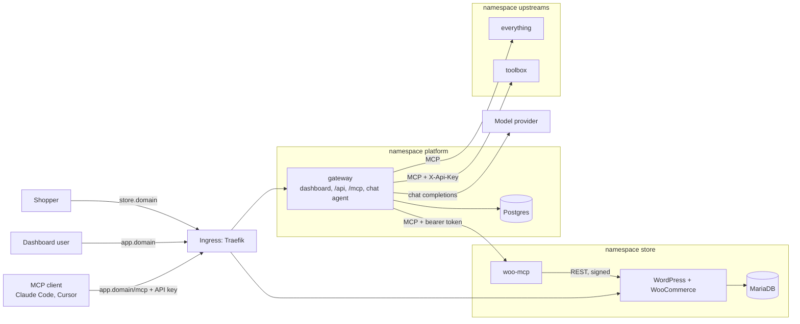

# System design and tradeoffs

A WooCommerce store, an MCP server for it, and a gateway that puts every MCP server
a team uses behind one endpoint and one API key per person. Everything runs on
Kubernetes and is installed with Helm.

## Components

| Namespace | Workload | What it does | Reachable from |
| --- | --- | --- | --- |
| `store` | WordPress + WooCommerce | The shop. Files on a volume. | Internet, through the Ingress |
| `store` | MariaDB | The shop's database. Data on a volume. | WordPress and the bootstrap Job |
| `store` | bootstrap Job | Makes a fresh WordPress shop-ready with WP-CLI; safe to run again on every upgrade. | Nothing |
| `store` | `woo-mcp` | Our MCP server: products and orders as tools. | Gateway pods only |
| `platform` | `gateway` | Dashboard, REST API, the aggregated `/mcp` endpoint, the chat agent. | Internet, through the Ingress |
| `platform` | Postgres | Users, API key hashes, servers and their encrypted credentials, audit log. | Gateway pods only |
| `upstreams` | `everything` | The MCP reference server: a third-party upstream with many tools. | Gateway pods only |
| `upstreams` | `toolbox` | A small second upstream of ours. It needs a custom-header credential and has an `echo` tool that collides with `everything`'s. | Gateway pods only |

Three charts, one per namespace: `charts/store`, `charts/platform`, `charts/upstreams`.

## Architecture choices

| Choice | Why | What it costs, or what was turned down |
| --- | --- | --- |
| **k3d locally, k3s on the VPS** | The same distribution in both places: the same Traefik ingress, the same `local-path` storage, the same NetworkPolicy enforcement. "Only values change" then holds in practice. | kind and minikube need a separately installed ingress controller and behave differently from a k3s VPS. |
| **Three charts, three namespaces** | Each is its own release, upgraded and rolled back on its own. The namespace is the boundary the NetworkPolicies are written against. | One more step at install time: the platform chart reads the upstream tokens from the other namespaces' Secrets, so those charts go in first. |
| **The gateway serves the dashboard** | One origin: no CORS, a plain same-site cookie, one fewer workload to probe and patch. | The dashboard cannot be scaled or cached separately. Putting it behind its own web server later is a small change. |
| **Postgres for gateway state** | Gateway pods hold nothing that matters, so more than one can run and a pod can be killed freely. | One more stateful workload than a SQLite file would need. |
| **Stateless MCP, on our servers and on the gateway** | Every request stands alone: no session lives in a pod, so any replica answers any request and a restart loses nothing. | The gateway cannot push "tool list changed" over a long-lived session to older clients; they see a change on their next list. |
| **Tools are always named `<slug>__<tool>`** | A collision cannot happen, and a tool's name never changes when another server is added. | Names are longer. Prefixing only on collision was turned down: it renames tools under clients that are already connected. |
| **The chat agent calls the same function as `/mcp`** | One code path checks permissions and writes the audit log, so the agent cannot skip either. | The agent does not exercise the HTTP layer of `/mcp`; the end-to-end script does that. |
| **`woo-mcp` talks to the store over the WooCommerce REST API** | See below. | |
| **TypeScript run directly by Node** | Node erases the types at load time, so there is no build step that can differ between tests and the image. `tsc` is the type checker only. | Only erasable syntax is allowed (no enums, no parameter properties). |
| **An OpenAI-compatible chat API** | One small client works with OpenRouter, most hosted providers and local model servers; provider and model are values. | Provider-specific features are not used. |

## The WooCommerce MCP server

`apps/woo-mcp` exposes five tools over Streamable HTTP: `list_products`,
`create_product`, `list_orders`, `get_order`, `update_order_status`.

**How it talks to the store: the WooCommerce REST API (`/wp-json/wc/v3`).**

- It is the documented, versioned interface, and it runs WooCommerce's own
  validation and hooks, so an order status change behaves exactly as one made in the admin.
- It works over the network, so the MCP server is an ordinary Deployment with its
  own credential and its own NetworkPolicy.
- **WP-CLI was turned down:** it needs to run inside the WordPress container, which
  means either giving the MCP server access to the Kubernetes API to exec into
  another pod, or sharing WordPress's volume and PHP with it.
- **Direct SQL was turned down:** it skips all of WooCommerce's logic and ties the
  server to a table layout that changes between versions.

**Authentication.** WooCommerce accepts HTTP Basic auth only over HTTPS. Traffic
inside the cluster is plain HTTP, because TLS ends at the Ingress. Over HTTP,
WooCommerce requires OAuth 1.0a signatures, which is what `woo-mcp` sends. A side
benefit: the consumer secret is never transmitted, only an HMAC made with it.
One detail matters: WooCommerce verifies the signature against the store's public
URL, not the address the request arrived at. So `woo-mcp` sends requests to
`http://wordpress` but signs them for `http://<store host>`, always with `http`,
even when the site is served over HTTPS.

**Other decisions.**

- "Today" means today in the store's timezone. `list_orders(date="today")` works
  that out on the server, so the model never does timezone arithmetic.
- Tool results are the handful of fields a model needs, not WooCommerce's full objects.
- Store failures become tool errors with one plain sentence ("Store is
  unreachable", "Not found"). Raw responses and stack traces stay in the pod's log.
- Its readiness check reports on the process only. If the store is down, the tools
  say so; the pod does not drop out of its Service.
- It has no Ingress, requires a bearer token only the gateway holds, and its
  NetworkPolicy admits only gateway pods.

## The gateway

### Aggregation and naming

The gateway keeps one long-lived MCP client per registered server, and a cached
copy of that server's tool list.

- **Listing never touches the network.** `tools/list` on the gateway is assembled
  from the caches of the servers that are connected right now. A dead or slow
  upstream cannot delay it or break it.
- **Name collisions.** Every tool is exposed as `<slug>__<tool>`: `woo__list_orders`,
  `everything__echo`, `toolbox__echo`. The slug is chosen by the admin, is unique,
  and matches `^[a-z][a-z0-9-]{1,30}$`, so it cannot contain an underscore. The
  gateway splits a name at the first `__`, which means an upstream's own tool names
  may contain `__` safely. Descriptions are prefixed with `[Server name]`.
- **Refresh.** Every few seconds the gateway calls `tools/list` on each upstream.
  That one call is both the health check and the cache refresh.

### How a tool call travels

A client calls `woo__list_orders`:

1. `POST https://app.<domain>/mcp` with `Authorization: Bearer ugw_...`.
2. Traefik routes the host to the `gateway` Service.
3. The gateway hashes the key, looks it up, and rejects it if it is unknown or
   revoked. This happens on every request, so a revoked key fails on its next call.
4. The name splits into server `woo` and tool `list_orders`. The gateway checks, in
   order: the server exists and is enabled; this user may use this tool; the server
   is connected; the tool is in its cached list.
5. The gateway's client for `woo` sends `tools/call list_orders` to
   `http://woo-mcp.store.svc:3000/mcp` with woo-mcp's bearer token, under a timeout.
6. `woo-mcp` validates the arguments and calls
   `GET http://wordpress/wp-json/wc/v3/orders` with an OAuth signature.
7. WooCommerce reads MariaDB and answers. `woo-mcp` trims the result and returns it.
8. The gateway writes the audit entry, then returns the result unchanged.

**Credentials per hop.** The client's API key ends at the gateway. The gateway's
token for woo-mcp ends at woo-mcp. woo-mcp's WooCommerce secret is never sent. No
credential travels further than the hop it was issued for.

### Failure handling

| What happens | What the caller gets | Audit outcome |
| --- | --- | --- |
| The tool runs | Its result, unchanged | `ok` |
| The tool reports an error, or the upstream rejects the arguments | That error, as a tool error | `error` |
| The upstream does not answer in time (30 s by default) | "`<Server>` did not respond within 30s" | `timeout` |
| The upstream is down | "`<Server>` is unreachable", immediately | `unreachable` |
| The server is disabled or removed, or the tool does not exist | "Tool ... is not available" | `not_found` |
| The user may not use the tool | "You are not allowed to use ..." | `denied` |
| The API key is revoked | HTTP 401 | `rejected` |

- **One upstream cannot hurt another.** Each has its own client, timeout and status.
  A call to a hung server occupies only that call.
- **A failed call triggers a re-check at once,** rather than waiting for the next
  timer tick, so the dashboard shows a dead server as Unreachable within seconds,
  with the reason in plain words ("Connection refused: nothing is listening at
  that address", "The server rejected the credential").
- **Disabling a server** removes its tools from the next listing and refuses calls
  to them, even from a client that still remembers the old list.
- **The gateway's own health checks do not depend on any upstream.** A dead
  upstream must not take the gateway out of service.

### Servers, replicas and Helm

- The `servers` table is the source of truth. Each gateway process reloads it on
  every tick and reconnects whatever changed, so several replicas converge on the
  same set without talking to each other.
- Servers listed in the platform chart's values are **managed**: applied on every
  start, so a rotated token arrives with a Helm upgrade. They can be disabled in
  the dashboard but not deleted there. Servers an admin adds in the dashboard are
  the admin's to edit and remove.
- Each upstream may have one static credential: a bearer token, or any header name
  with a value. It is encrypted at rest, write-only in the API, attached only to
  that upstream's requests, and never follows a redirect.

### People, keys and the audit log

- Two roles. **Admins** manage servers, members and tool permissions. **Members**
  use tools, manage their own keys, and see their own audit entries.
- Members join through a single-use invite link and set their own password.
- Each person creates their own API keys (`ugw_` plus 256 random bits). A key is
  shown once; only its SHA-256 is stored. The owner or an admin can revoke it.
- **Tool permissions:** an admin can make any tool admin-only. For a member, that
  tool is missing from the list and refused if called by name.
- **Audit log:** one row per tool call with user, channel (`mcp` or `chat`), server,
  tool, time, duration, outcome and error text. It is written before the result is
  returned.

### The chat agent

`POST /api/chat` runs a tool loop and streams each step to the page as one JSON
line: the tool being called and its arguments, the result and how long it took,
then the answer.

1. List the tools the logged-in user may use right now. This is done on every
   message, so a server disabled a moment ago is already gone.
2. Send the conversation and the tool definitions to the model.
3. If the model asks for tools, call each through the same `callTool()` the MCP
   endpoint uses, as the logged-in user, and send the results back to the model.
4. Repeat until the model answers, or eight steps have passed.

Because step 3 is the same function, the agent's calls obey the same permissions
and land in the same audit log, marked `chat`, under that user's name.

## Kubernetes

**What is public.** Two hosts, both through the Ingress: `store.<domain>` and
`app.<domain>`. Everything else is a ClusterIP Service with no Ingress.

**How "internal only" is enforced.** Twice. There is no route in from outside, and
each namespace has a default-deny NetworkPolicy with a short list of allowed paths:

| From | To |
| --- | --- |
| Ingress controller | WordPress, gateway |
| WordPress, bootstrap Job | MariaDB; the internet (plugin downloads, updates) |
| woo-mcp | WordPress |
| gateway | Postgres; pods in `store` and `upstreams`; the internet (model provider, remote MCP servers) |
| `everything`, `toolbox` | nothing |

`scripts/e2e.sh` checks this from a throwaway pod in another namespace, with the
Kubernetes API as the control that proves the probe has a network.

**Storage.** MariaDB's data, WordPress's files and Postgres's data are on
PersistentVolumeClaims. WordPress runs with the `Recreate` strategy, because its
volume can be mounted by one node at a time.

**Secrets.** Every credential is generated by Helm in the cluster on first install
(`randAlphaNum`), read back with `lookup` on every upgrade so it never changes, and
kept on uninstall, because the volumes outlive a release and the passwords inside
them must too. Nothing secret is in the repository or a values file.

**Every workload** has readiness and liveness probes and resource requests and
limits. Readiness never depends on another service's health: when a dependency is
down, the pod stays in service and reports the problem, instead of the whole
endpoint disappearing.

## What changes for production

The templates are identical. Only values differ.

| Concern | Local (`values-local.yaml`) | VPS (`values-prod.yaml`) |
| --- | --- | --- |
| **DNS** | `*.127.0.0.1.nip.io`, a public wildcard that resolves to `127.0.0.1`. No `/etc/hosts` edits. | A real domain with `store.` and `app.` records pointing at the VPS, or `<ip>.sslip.io`. |
| **Ingress** | Traefik over plain HTTP. | Traefik with TLS: the Ingress gets a cert-manager issuer annotation and a `tls` block. Cookies become `Secure`. |
| **Storage class** | `local-path`, small volumes. | `local-path` on a single-node k3s, larger volumes. On a managed cluster, set the class to the provider's. |
| **Images** | Built locally and imported into k3d. | Pulled from a registry; repository and tag are values. |
| **Secrets** | Generated in the cluster. The LLM key comes from a gitignored values file. | The same. For a team, the next step is an external secret store. |
| **Resources** | Small requests, sized for a laptop. | Larger limits and volumes. |

**Upgrade and rollback.** Each chart is its own release:
`helm upgrade <release> charts/<chart> -n <namespace> -f ...` and
`helm rollback <release> <revision> -n <namespace>`.

- **Store.** The bootstrap Job runs again after an upgrade and only changes what
  differs. A rollback restores Kubernetes objects, not database contents: products
  and orders are untouched in both directions.
- **Gateway.** Migrations run at start under a database lock, so replicas starting
  together take turns. Migrations only add, so the previous image still runs against
  the newer schema after a rollback.
- **Volumes and Secrets** are never deleted by an upgrade, a rollback or an uninstall.

## Limits worth knowing

- The model sees every permitted tool on every turn. With many servers that
  becomes too much context; the next step is a pair of search-then-call meta-tools.
- No rate limit per key on `/mcp`.
- No OAuth: clients authenticate with an API key only.
- Sessions are signed cookies with no server-side record; removing the user is how
  a stolen session is cut off.
- The remaining security limits are in [THREAT_MODEL.md](THREAT_MODEL.md).
