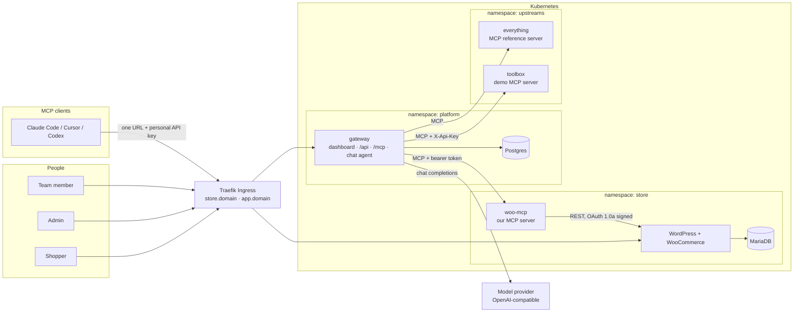
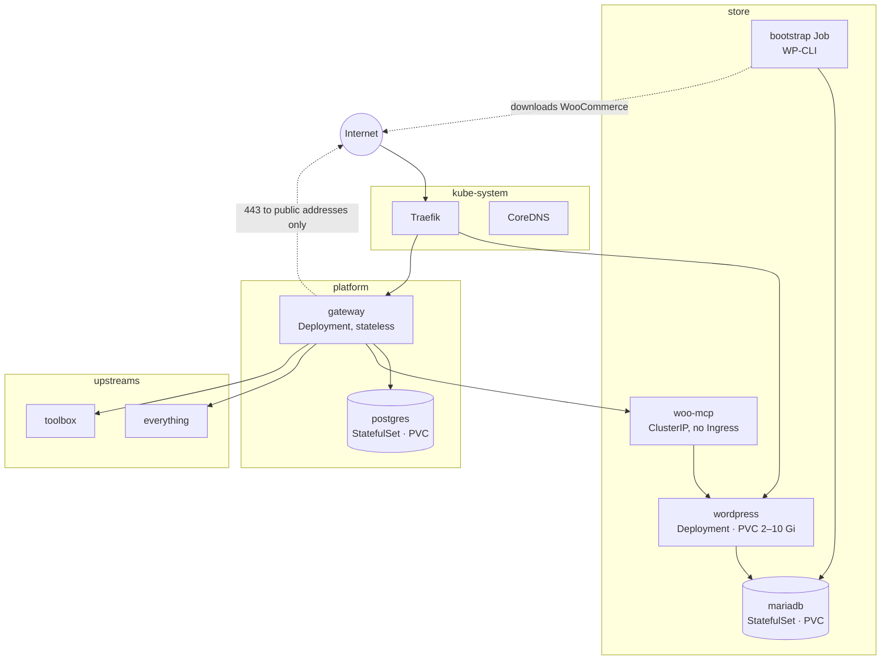
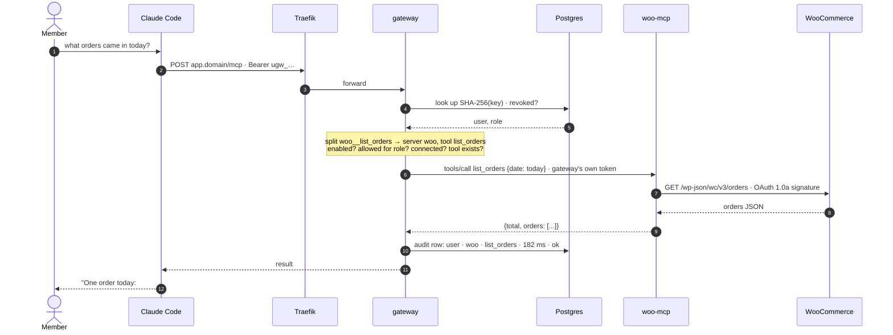
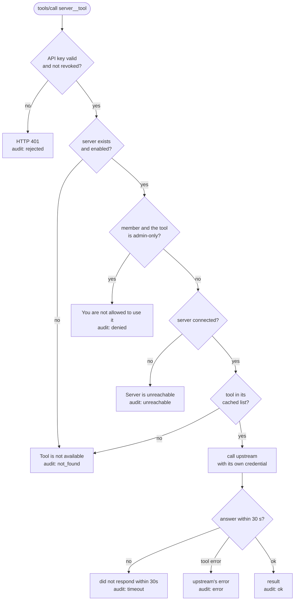
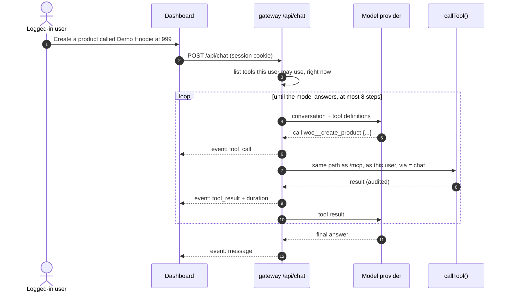
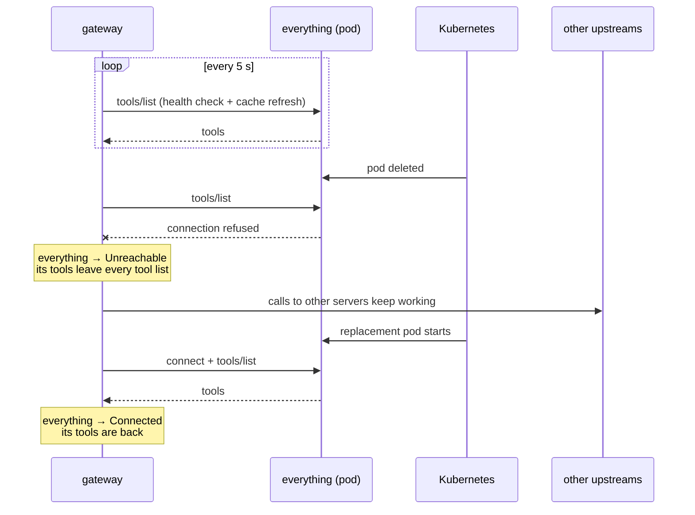
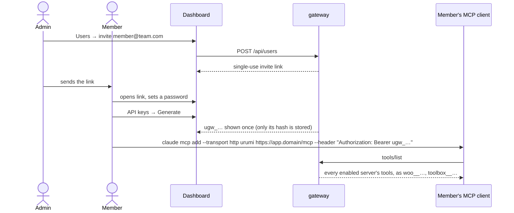
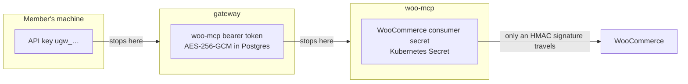
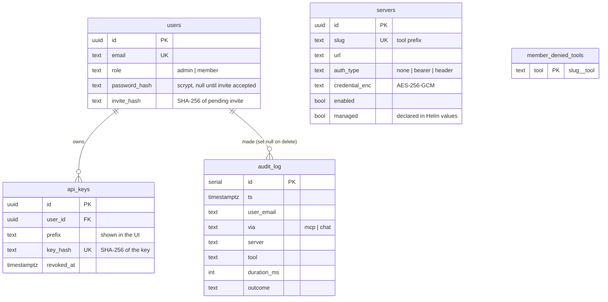

# Architecture

Diagrams of how the pieces fit and how a request moves through them. The reasoning
behind each choice is in [DESIGN.md](DESIGN.md); the security view is in
[THREAT_MODEL.md](THREAT_MODEL.md).

- [System overview](#system-overview)
- [Kubernetes topology](#kubernetes-topology)
- [A tool call, end to end](#a-tool-call-end-to-end)
- [How the gateway decides](#how-the-gateway-decides)
- [The chat agent's loop](#the-chat-agents-loop)
- [When an upstream dies](#when-an-upstream-dies)
- [Onboarding a teammate](#onboarding-a-teammate)
- [Where each credential stops](#where-each-credential-stops)
- [Data model](#data-model)

## System overview

| Piece | Code | What it does |
| --- | --- | --- |
| WordPress + WooCommerce | [`charts/store`](../charts/store) | The shop. A WP-CLI Job installs and configures it. |
| woo-mcp | [`apps/woo-mcp`](../apps/woo-mcp) | Five tools over the store's REST API. Internal only. |
| gateway | [`apps/gateway`](../apps/gateway) | Upstream registry, `/mcp`, dashboard API, audit log, chat agent. |
| dashboard | [`apps/dashboard`](../apps/dashboard) | React app, served by the gateway. |
| everything, toolbox | [`charts/upstreams`](../charts/upstreams) | Two more upstreams, one with a header credential and a colliding tool name. |
| urumi-mcp CLI | [`packages/urumi-mcp`](../packages/urumi-mcp) | Bridges any stdio MCP client to a gateway; runs woo-mcp on its own. |

## Kubernetes topology

Every namespace denies all traffic by default. The arrows are the only paths a
NetworkPolicy allows.

| Workload | Kind | Probes | Runs as |
| --- | --- | --- | --- |
| mariadb | StatefulSet + PVC | `healthcheck.sh` connect / InnoDB ready | uid 999, no capabilities |
| wordpress | Deployment (`Recreate`) + PVC | startup TCP, ready `GET /wp-login.php`, live TCP | image default (Apache drops to www-data) |
| bootstrap | Job (Helm hook) | n/a, runs to completion | uid 33 |
| woo-mcp | Deployment | `GET /healthz` | uid 1000, read-only root, no capabilities |
| gateway | Deployment | ready `GET /readyz` (Postgres), live `GET /healthz` | uid 1000, read-only root, no capabilities |
| postgres | StatefulSet + PVC | `pg_isready` | uid 70, no capabilities |
| everything, toolbox | Deployment | TCP | uid 1000, read-only root, no capabilities |

## A tool call, end to end

A member asks Claude Code "what orders came in today?".

The audit row is written before the result is returned, so a client never gets a
result that is not in the log.

## How the gateway decides

Every call, from an MCP client or from the chat agent, goes through the same function
([`gateway.ts`](../apps/gateway/src/gateway.ts)).

## The chat agent's loop

The agent never gets its own credentials or a separate path: it calls the same
function as an external client, so permissions and the audit log apply unchanged.

## When an upstream dies

Listing never waits on an upstream: `tools/list` is served from the cache of the
servers that are connected right now.

## Onboarding a teammate

## Where each credential stops

No credential travels further than the hop it was issued for, and no client token
is ever forwarded to an upstream.

## Data model

Gateway state in Postgres ([`schema.ts`](../apps/gateway/src/lib/schema.ts), migrations
in [`apps/gateway/drizzle`](../apps/gateway/drizzle)).

